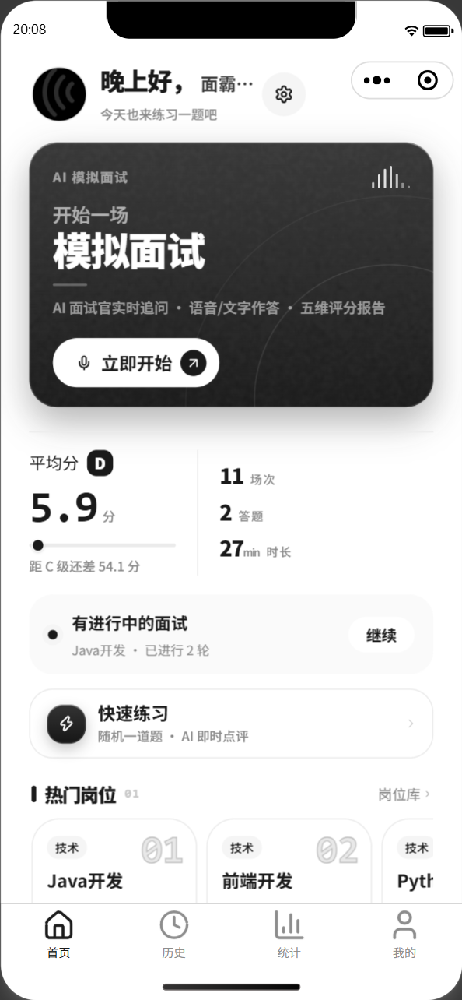
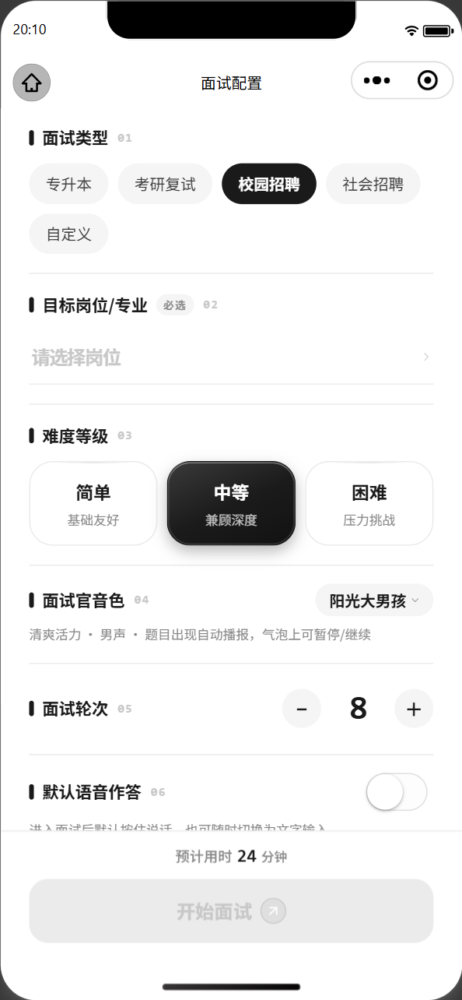
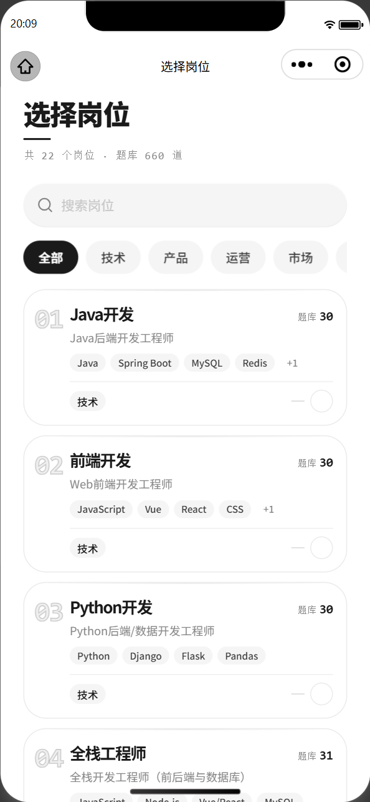
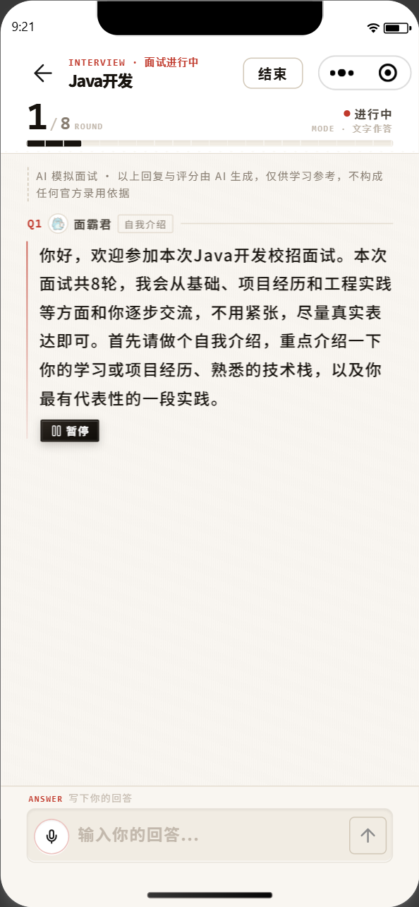
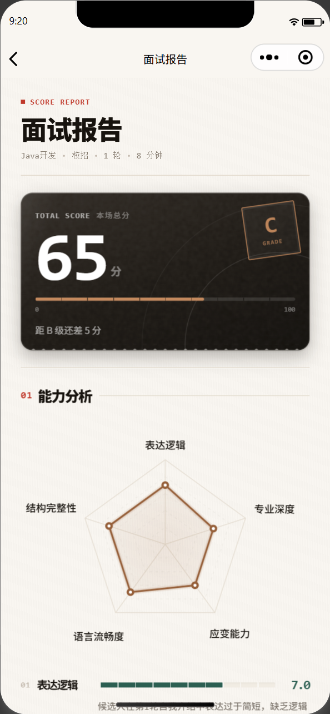
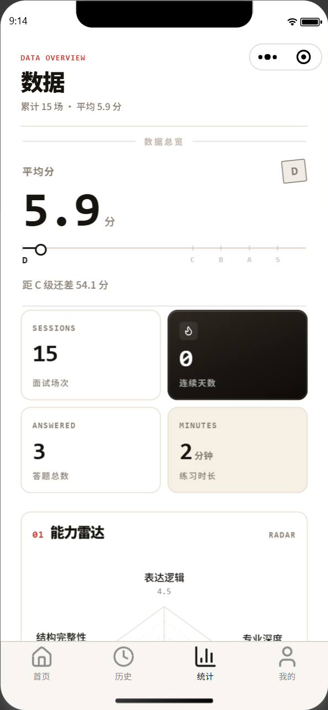
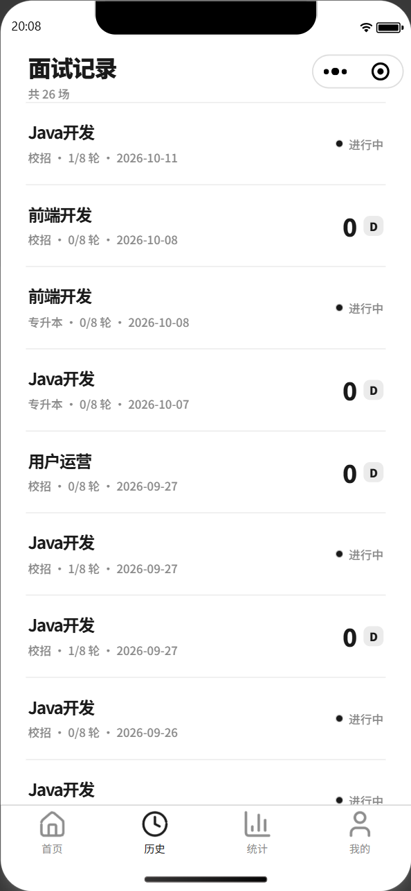
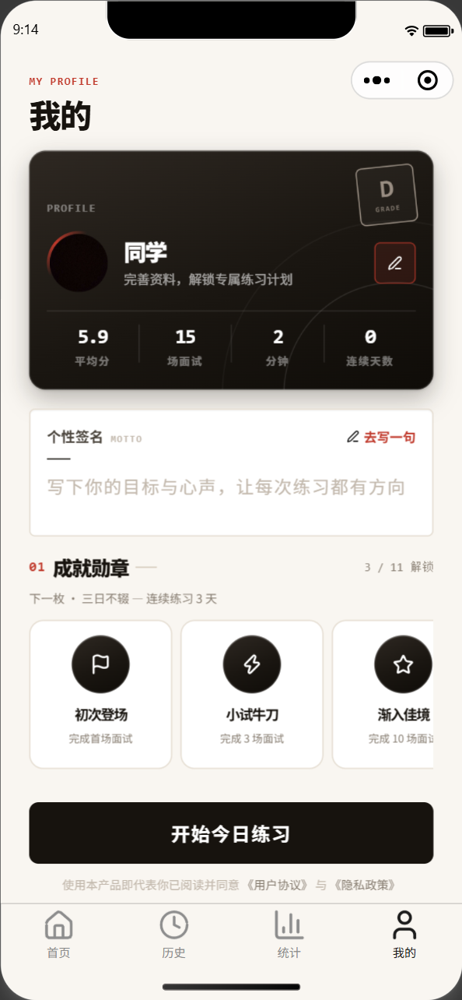
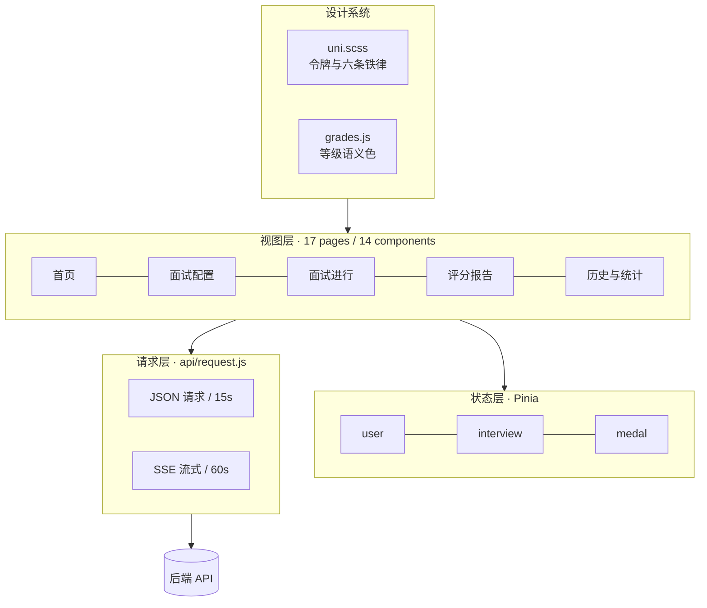
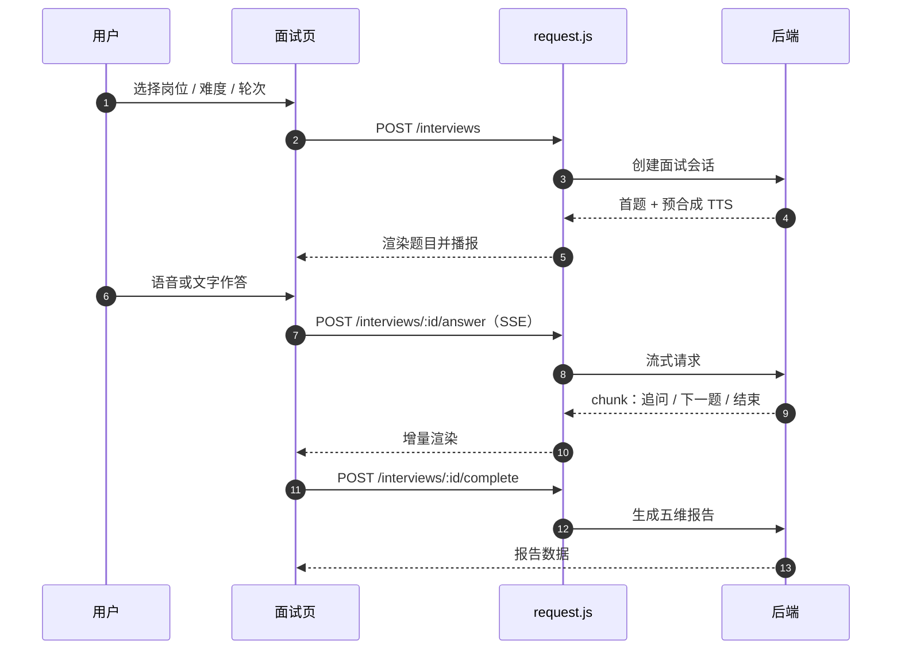

<div align="center">

# 我的面试小屋

**AI 驱动的实时面试模拟微信小程序 · 前端**

<p>
  
  
  
  
  
  
  
</p>

<p>
  <sub>选岗位 → AI 面试官多轮追问 → 语音 / 文字作答 → 五维评分报告。<br/>
  An AI-powered mock interview mini program built with uni-app + Vue 3.</sub>
</p>

</div>

> 本仓库只包含前端代码，后端服务未包含在内。运行完整流程需要自行准备兼容的接口服务。

## 界面预览 · v35 纸本朱砂

<p align="center">
  
  &nbsp;
  
  &nbsp;
  
  &nbsp;
  
</p>
<p align="center">
  
  &nbsp;
  
  &nbsp;
  
  &nbsp;
  
</p>
<p align="center"><sub>截图来自微信开发者工具，昵称与数据均为脱敏测试数据。</sub></p>

## 这不是一个表单套壳

它要在微信小程序的硬约束下完成一场接近真实的面试：流式对话、语音作答、多轮追问、五维评分、历史统计。前端真正要解决的是三件事——**对话的实时感、评分的可读性、弱网与过载下的可用性**。

### 1. 小程序里的 SSE 流式对话

微信小程序没有 EventSource。这里用 `uni.request` 的 `enableChunked` + `onChunkReceived` 自己拼流：

```js
const task = uni.request({
  url: BASE_URL + url,
  method: 'POST',
  responseType: 'arraybuffer',
  enableChunked: true,
  success: handleDone,
  fail: handleFail
})

task.onChunkReceived(({ data }) => {
  onChunk(decodeChunk(data))   // 增量渲染，而不是等一整个响应
})
```

细节：

- `TextDecoder` 不可用时手写 UTF-8 解码兜底，兼容不同基础库
- 流式请求 60s 超时；每收到一个 chunk 重置计时，避免长回答被误杀
- 普通请求 15s，语音上传 30s，按链路区分
- 401 时清内存态 → 重新 `wx.login` → 只重试一次，避免死循环

### 2. 零图表库的自绘 SVG

Canvas 2D 在小程序同层渲染下层级最高，弹层和遮罩盖不住，部分机型还会退化。所以雷达图、趋势图、日历热力图全部是**手写 SVG**，经 data-URL 交给 `<image>` 渲染。

- 没有 ECharts、没有 canvas 2d、没有 renderjs
- 层级正常，弹层可覆盖，截图稳定
- 代价是坐标、刻度、动画插值都要自己实现

### 3. 构建期烘焙的图标变形

麦克风 ↔ 键盘、加号 ↔ 减号等交互反馈不是 GIF 或视频，而是把图标轮廓做极坐标重采样后插值成帧序列：

- 构建期生成帧，运行期只换 `<image src>`
- 真机零逐帧计算，避免小程序端的卡顿
- 帧缺失时静默回退静态图标，不出现白块

### 4. 设计系统不是一份色板

设计系统 v35「纸本朱砂 · 压印版」以 `src/uni.scss` 为唯一事实源，包含令牌、mixin 和六条硬性规则：单一底色、压印优先于阴影、数字等宽、圆角收敛、字号靠比例差、动效统一缓出。

等级色是产品语义的一部分，不是装饰：

| 等级 | 纸面色 | 墨面提亮 | 含义 |
| --- | --- | --- | --- |
| S | `#A8842C` 鎏金 | `#D9B45A` | 90–100 |
| A | `#C0392B` 朱砂 | `#E8664F` | 80–89 |
| B | `#2C5F52` 墨青 | `#5FAA8E` | 70–79 |
| C | `#96603A` 赭石 | `#C4895D` | 60–69 |
| D | `#7E7468` 石灰 | `#A1968A` | < 60 |

一级色是为纸面调的，压在深色卡片上对比度只有约 3:1，所以深色区域一律使用提亮版。SCSS 的 `$grade-*` 与 JS 侧 `utils/grades.js` 必须同步修改。

### 5. 失败路径也当作功能设计

- **上游过载**：识别 429 / 503 / `UPSTREAM_OVERLOAD`，换成「当前练习人数较多」并给出替代操作，而不是把 `timeout of 30000ms` 甩给用户
- **网络抖动**：微信登录链路最多 3 次退避重试
- **AI 评分失败**：显示「本次未能评分」，不伪造默认分
- **生产构建**：忽略 storage 里的接口地址覆盖，防止联调残留把线上流量打到测试环境

### 6. 隐私与安全边界

- 前端不落任何模型或云服务密钥，所有 AI 调用只在服务端
- 登录态为服务端签发的 JWT；openid 只下发脱敏指纹
- H5 模拟登录被 `#ifndef MP-WEIXIN` 编译剔除，不会进入小程序包
- `.env.example` 只有占位符，真实接口地址由构建环境注入

## 功能

| 模块 | 能力 |
| --- | --- |
| 面试配置 | 面试类型、目标岗位、难度、音色、轮次、语音/文字模式 |
| 实时面试 | AI 面试官多轮对话、追问判定、流式回答、题目 TTS 播报 |
| 语音作答 | 原生录音 + 服务端 ASR，失败自动降级为键盘输入 |
| 评分报告 | 五维加权评分、逐轮点评、雷达图、等级印章 |
| 历史与统计 | 面试记录、趋势、日历热力图、能力雷达、勋章体系 |
| 分享 | 成绩海报生成与保存 |

## 架构



一场面试的完整链路：



更详细的分层、决策取舍和降级策略见 [docs/ARCHITECTURE.md](docs/ARCHITECTURE.md)。

## 技术栈

- **框架**：uni-app 3 + Vue 3.4 + Vite 5
- **状态**：Pinia（user / interview / medal）
- **请求**：`uni.request` 封装，JSON + SSE 双通道
- **图表**：手写 SVG（雷达图 / 趋势 / 热力图）
- **图标**：Lucide 几何 + 构建期烘焙的 morph 帧序列
- **样式**：SCSS 设计令牌，无第三方 UI 组件标签

## 目录结构

```
src/
├── api/            # 请求封装，含 SSE 流式与 401 自愈
├── components/     # 通用组件（图表、海报、语音、弹层等）
├── composables/    # 组合式函数
├── pages/          # 17 个页面
├── static/         # 静态资源与 tabBar 图标
├── store/          # Pinia：user / interview / medal
├── utils/          # 图标、等级色、音频、格式化、导航
├── App.vue
├── main.js
├── manifest.json
├── pages.json
└── uni.scss        # 设计令牌与六条铁律
scripts/            # 语法校验、tabBar 图标生成、构建后自愈
tests/              # Vitest：等级映射、格式化、图表配置
docs/               # 架构说明与界面截图
```

## 快速开始

环境要求：Node.js 20+、npm 9+、微信开发者工具。

```bash
npm install
cp .env.example .env.local
```

Windows PowerShell：

```powershell
Copy-Item .env.example .env.local
```

编辑 `.env.local`：

```
VITE_API_BASE_URL=https://your-domain.example.com/api/v1
VITE_API_BASE_URL_DEV=http://127.0.0.1:3100/api/v1
```

开发（微信小程序）：

```bash
npm run dev:mp-weixin
```

然后用微信开发者工具导入 `dist/dev/mp-weixin`。

生产构建：

```bash
npm run build:mp-weixin
```

产物在 `dist/build/mp-weixin`。仓库根目录的 `project.config.json` 已把 `miniprogramRoot` 指向该目录，也可以直接导入仓库根目录。

H5 预览：

```bash
npm run dev:h5
```

H5 下的登录走本地模拟态，仅用于界面预览；业务数据仍需要后端接口。

## 环境变量

| 变量 | 说明 |
| --- | --- |
| `VITE_API_BASE_URL` | 生产构建使用的接口地址，必须是 HTTPS 域名，不能带端口和路径 |
| `VITE_API_BASE_URL_DEV` | 开发构建使用的接口地址，默认 `http://127.0.0.1:3100/api/v1` |

构建期由 `vite.config.js` 通过 `define` 注入为 `__API_BASE_URL__` / `__API_BASE_URL_DEV__`。小程序构建不支持 `import.meta.env`，所以没有直接用 Vite 的默认注入方式。

`.env.local` 已被 `.gitignore` 忽略，不会入库。

## 工程化

| 命令 | 作用 |
| --- | --- |
| `npm run dev:mp-weixin` | 微信小程序开发构建 |
| `npm run build:mp-weixin` | 生产构建，并自动补拷静态资源 |
| `npm run dev:h5` / `build:h5` | H5 预览与构建 |
| `npm test` | Vitest 单元测试：等级边界、日期/时长格式化、图表配置 |
| `node scripts/checkSyntax.js` | 不依赖构建，对全部 JS 和 `.vue` 的 `<script>` 做语法校验 |

`postbuild:mp-weixin` 会重新同步 `src/static` 到产物并刷新 mtime。微信开发者工具占用文件时，uni-app 自带的 static 拷贝可能静默失败，这一步用来兜底。

CI 见 [.github/workflows/ci.yml](.github/workflows/ci.yml)：Node 20 上安装依赖、语法校验、单元测试、生产构建。

## 已知约束与设计取舍

- **主包 2MB**：17 个页面全部在主包，无分包。图表、图标因此都选择零运行时依赖的方案。
- **不使用 Skyline**：现有布局与 SVG 图表依赖 WebView 渲染模型，迁移需要整体返工，属于明确的设计决策。
- **不引入第三方 UI 库**：`uview-plus` 只用于主题变量，全站 0 个 `<u-*>` 组件标签。
- **后端未开源**：本仓库聚焦前端。接口统一返回 `{ code, message, data }`，AI 回答走 SSE。

## 小程序配置

1. 在 `src/manifest.json` 的 `mp-weixin.appid` 填入自己的 AppID；留空时微信开发者工具会使用测试号。
2. 在微信公众平台「开发设置 → 服务器域名」把生产接口域名加入 request 合法域名。
3. 用真机体验版验证域名和隐私接口，不要只依赖开发者工具的「不校验合法域名」。
4. 麦克风、相机、相册相关功能需要在公众平台配置《小程序用户隐私保护指引》。

## License

代码以 MIT 许可证开源，详见 [LICENSE](./LICENSE)。

产品名称「我的面试小屋」、吉祥物形象、界面设计稿与截图不随 MIT 授权。

第三方依赖许可：Lucide（ISC）、morphicons（MIT）、uview-plus（MIT）、@tabler/icons（MIT）、uni-app / Vue（MIT）。
