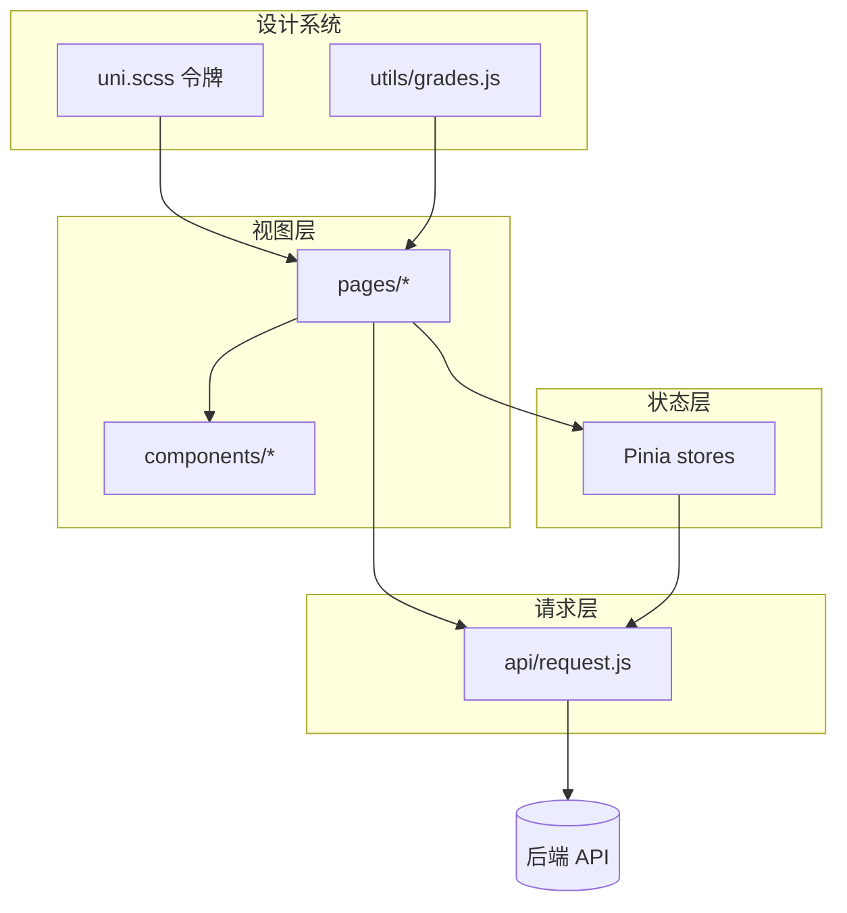
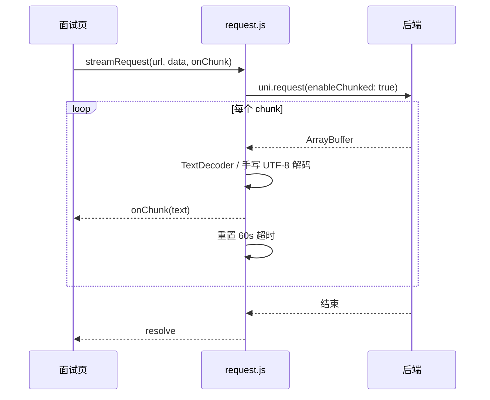
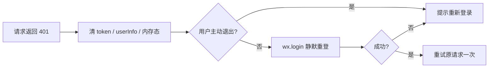

# 架构与关键决策

本文记录前端在微信小程序约束下的分层、关键取舍和失败处理方式。面向想快速理解代码的人，也面向面试时的追问。

## 1. 目标与约束

产品目标：用户选岗位后，与 AI 面试官进行多轮实时对话，支持语音或文字作答，结束后生成五维评分报告。

硬约束：

| 约束 | 影响 |
| --- | --- |
| 小程序主包 2MB | 不能引入大体积图表库 / UI 库，17 个页面全部在主包 |
| 无 EventSource | 流式回答必须基于 `uni.request` 的 chunk 能力自己实现 |
| Canvas 同层渲染 | 图表不能依赖 canvas 2d，否则弹层和遮罩会被盖住 |
| 无 DOM | 图标变形动画不能用 SVG 运行时 morph，必须预生成帧 |
| 基础库差异 | `TextDecoder`、录音、剪贴板等能力需要降级分支 |

## 2. 分层



职责边界：

- `pages/`：页面编排、生命周期、交互状态
- `components/`：可复用视图，不直接发请求
- `store/`：跨页面状态（登录态、当前面试、勋章）
- `api/`：URL、超时、鉴权、错误归一化、SSE 解码
- `utils/`：纯函数与静态资源（图标、颜色、格式化、音频）

## 3. 关键决策

| 决策 | 备选方案 | 选择原因 |
| --- | --- | --- |
| 手写 SVG 图表 | ECharts / canvas 2d | canvas 同层渲染层级最高，弹层盖不住；SVG 走 `<image>` 层级正常 |
| 构建期烘焙 morph 帧 | 运行时 SVG 插值 / GIF / Lottie | 小程序无 DOM，运行时插值成本高；烘焙后只换 `src`，真机零计算 |
| 零 UI 组件库 | uview-plus / vant-weapp | 主包体积敏感；uview-plus 只保留主题变量，组件全部自绘 |
| SSE 自实现 | WebSocket | 后端是普通 HTTP 流；WebSocket 需要额外的连接管理与鉴权 |
| 设计令牌集中在 SCSS | CSS-in-JS / 组件内写死 | 小程序构建链对 SCSS 支持稳定，令牌可被所有页面共享 |
| 等级色双端同步 | 只维护 SCSS | JS 内联样式与 SVG 字面量拿不到 SCSS 变量，必须保留 JS 镜像 |

## 4. SSE 流式回答



实现要点：

- `responseType: 'arraybuffer'` + `enableChunked: true`
- `TextDecoder` 存在时用 stream 模式；不存在时按 UTF-8 字节手动解码
- 每个 chunk 重置看门狗定时器，避免长回答被固定超时误杀
- 失败时统一归一化为 `{ statusCode, message }`，由页面决定是否提示
- 401 只重试一次，避免登录态失效时无限循环

## 5. 图表渲染链路

```
数据 → 计算坐标/刻度 → 拼 SVG 字符串 → encodeURIComponent → data:image/svg+xml
     → <image src="..."> → 由小程序原生渲染
```

涉及：

- `components/echart/echart.vue`：折线/柱状等通用图
- `components/score-radar/score-radar.vue`：五维能力雷达
- `components/calendar-heatmap/calendar-heatmap.vue`：练习日历热力图

代价：所有坐标、刻度、动画插值都要自己实现；收益是层级正确、无第三方运行时、截图稳定。

## 6. 图标变形链路

```
Lucide 图标路径 → 轮廓重采样 → 极坐标插值 → 帧序列
             → 构建期写入 utils/morph-icons.js
             → 运行期 <image src> 逐帧切换
```

- 帧序列是静态数据，运行期不做几何计算
- 组件在帧缺失时回退到静态图标，保证不会出现空白
- 静态图标与变形图标同源于 Lucide，视觉风格一致

## 7. 登录与请求自愈



- 用户主动退出会写本地标记，避免 `wx.login` 无感重登让「退出」形同虚设
- 重试带 `_authRetry` 标记，只允许一次
- 清 storage 的同时必须清 Pinia 内存态，否则 `isLoggedIn` 仍是旧值

## 8. 失败降级

| 场景 | 处理 |
| --- | --- |
| 网络抖动 | 登录链路最多 3 次退避重试 |
| 请求超时 | 普通 15s / 上传 30s / AI 流 60s，分别提示 |
| 上游 429 / 503 | 统一识别为「服务繁忙」，提示替代操作，同一会话只弹一次模态 |
| TTS 失败 | 提示可直接阅读题目，不中断答题 |
| ASR 失败 | 提示改用键盘输入 |
| AI 评分失败 | 显示「本次未能评分」，不使用伪造默认分 |
| 静态资源拷贝失败 | `postbuild` 脚本重新同步并刷新 mtime |

## 9. 质量守卫

- `scripts/checkSyntax.js`：不依赖构建，对 `.js` 与 `.vue` 的 `<script>` 做语法校验
- `scripts/ensure-static.js`：构建后补拷 `src/static`，解决开发者工具占用文件导致的静默失败
- GitHub Actions：Node 20 上安装、语法校验、小程序生产构建

## 10. 目录职责速查

| 目录 | 放什么 | 不放什么 |
| --- | --- | --- |
| `api/` | URL、鉴权、超时、错误归一化 | 业务状态、页面跳转 |
| `store/` | 跨页面共享状态 | 视图样式 |
| `components/` | 可复用视图与纯展示逻辑 | 直接请求后端 |
| `utils/` | 纯函数、静态图标、颜色映射 | 页面生命周期 |
| `pages/` | 编排、生命周期、交互 | 底层请求细节 |
